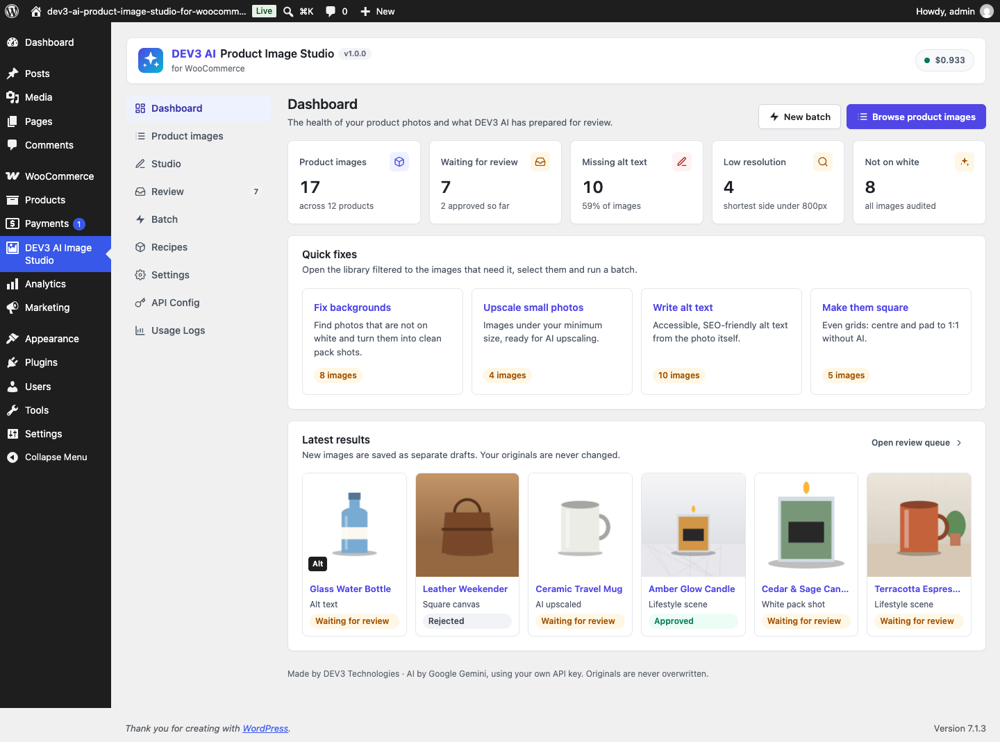

# DEV3 AI Product Image Studio for WooCommerce

AI background removal, white-background pack shots, lifestyle scenes, upscaling and alt text for WooCommerce product images, with batch mode and before/after approval.



## Features

DEV3 AI Product Image Studio turns everyday product photos into clean, consistent shop images, right inside WooCommerce.

* **Remove background** to pure white, any colour, or a transparent PNG.
* **White pack shots**: centred, evenly lit, square canvas with your fill % and an optional soft shadow (marketplace-ready).
* **Lifestyle scenes**: place the product on a kitchen counter, marble, wood, outdoors… or describe your own setting. 1-4 variants, any aspect ratio, brand style.
* **AI upscale**: restore detail, then enlarge 2-4x.
* **Custom edit**: "remove the price sticker", "straighten the label".
* **Alt text, title and caption** written from the photo itself, or from a template without AI.
* **Batch mode**: run any edit or recipe over a category, a selection or your whole catalogue in the background.
* **Originals are never overwritten.** Every result is a new image that waits in the review queue with a before/after slider. Approve to replace the image in the product (or add it to the gallery); revert at any time.
* **Works without AI**: square canvas, resize, flatten, format conversion, alt templates, the image audit and the review queue need no API key.
* Product image library with health filters (missing alt, low resolution, not on white, not square), product metabox, Products bulk action and media library link.
* "Before & After Image" block and `[dev3is_compare]` shortcode for your storefront.

AI is powered by Google AI with your own API key. The key stays on your server.

## Requirements

- WordPress 6.0 or newer (tested up to 6.8)
- PHP 7.4 or newer
- WooCommerce 8.0 or newer (required)
- Optional: your own Google AI API key (from Google AI Studio) to switch on the DEV3 AI features. The rest of the plugin works without one.

## Installation

### From the release zip

1. Download `dev3-ai-product-image-studio-for-woocommerce.zip` from the [latest release](https://github.com/dev3tech/dev3-ai-product-image-studio-for-woocommerce/releases/latest).
2. In WordPress, go to **Plugins → Add New → Upload Plugin**, choose the zip and click **Install Now**.
3. Click **Activate**.

### Build from source

```bash
git clone https://github.com/dev3tech/dev3-ai-product-image-studio-for-woocommerce.git
cd dev3-ai-product-image-studio-for-woocommerce
composer install --no-dev
npm ci
npm run build
```

Then copy the `dev3-ai-product-image-studio-for-woocommerce` folder into `wp-content/plugins/` and activate it.

### Getting started

1. Upload the zip in Plugins › Add New › Upload Plugin and activate (WooCommerce must be active).
2. Open **DEV3 AI Image Studio › API Config** and paste your Google AI API key (free at https://aistudio.google.com/apikey).
3. Open **Product images**, pick an image and choose an edit. Full documentation is in the Documentation folder of the download.

## FAQ

### Are my original photos changed?
No. Results are saved as new media files. Approving swaps the attachment used by the product; the original stays in your media library and Revert puts it back.

### Can it make real transparent PNGs?
Yes. The AI paints the product on a key colour and the plugin cuts it out on your server into a PNG with alpha.

### What does it cost?
You pay Google for your own API usage. Set a monthly budget in API Config; AI pauses when it is reached.

### Which data is sent to Google?
Only the product image being edited (downscaled to 1536 px), the product name, and for alt text the category and attributes.

## Privacy

When you use an AI feature, the image and the product name are sent to Google AI (Google LLC) as processor. A privacy-policy snippet is added to Settings › Privacy.

## Documentation

The full HTML guide (installation, settings, hooks and FAQ) is in [`docs/index.html`](docs/index.html). Open it in a browser after cloning or downloading the repository.

## Changelog

### 1.0.0
* Initial release.

## Licence

Released under the GNU General Public License v2.0 or later (GPL-2.0-or-later). See [LICENSE](LICENSE).

## More from DEV3

- [DEV3 AI Product Image Studio for WooCommerce on the DEV3 Marketplace](https://www.dev3.tech/item/dev3-ai-product-image-studio-for-woocommerce)
- [More WordPress plugins, themes and templates from DEV3](https://www.dev3.tech/marketplace)
